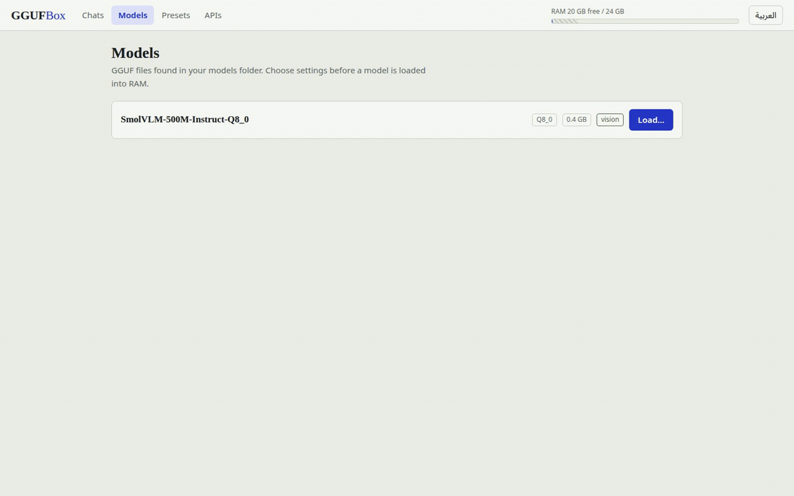
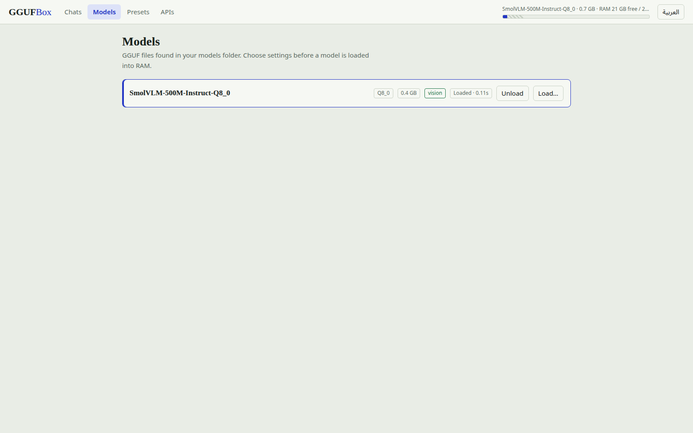
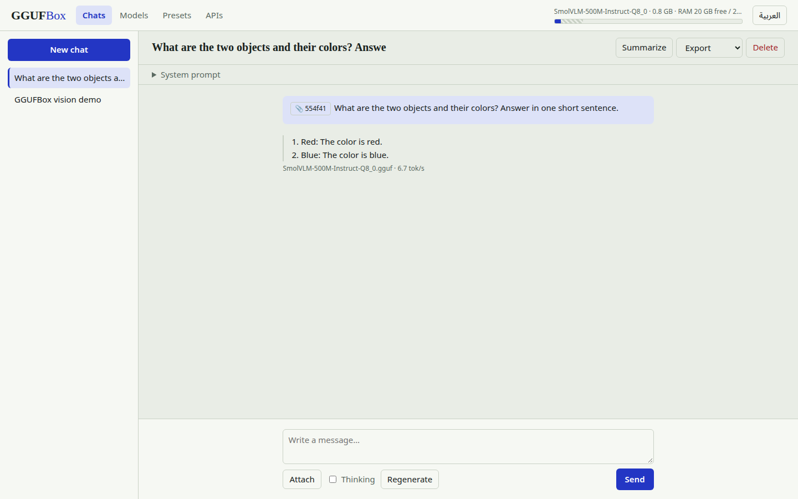
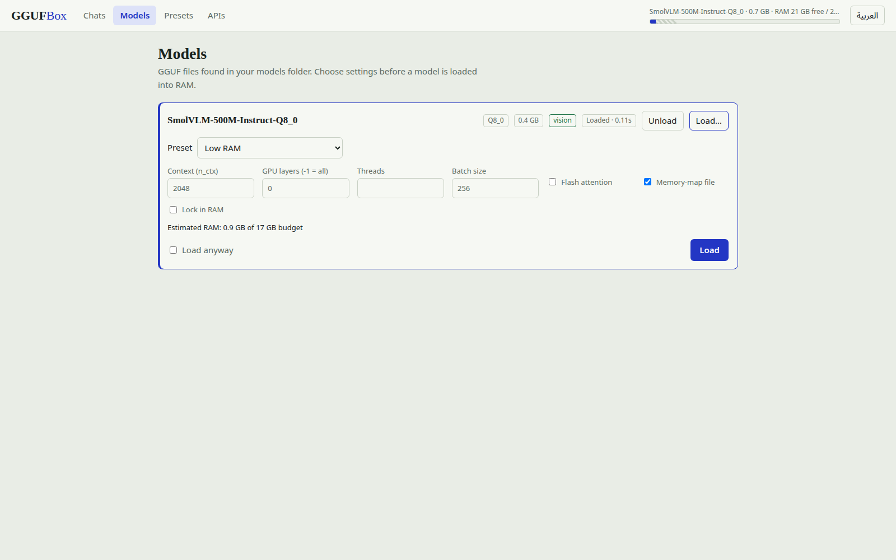
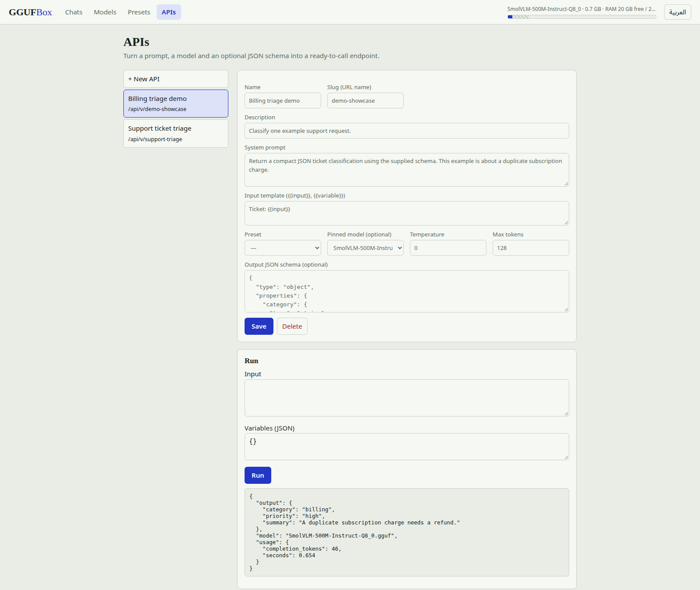
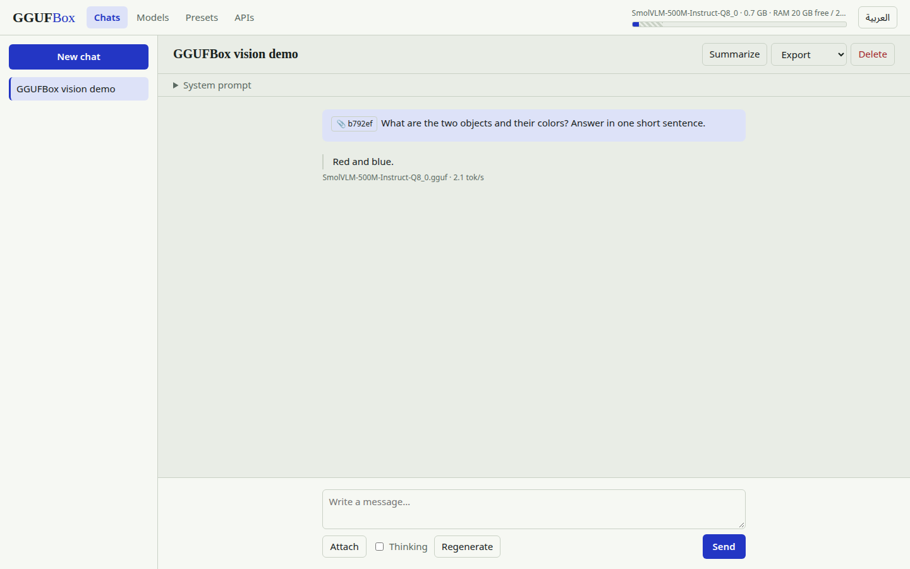
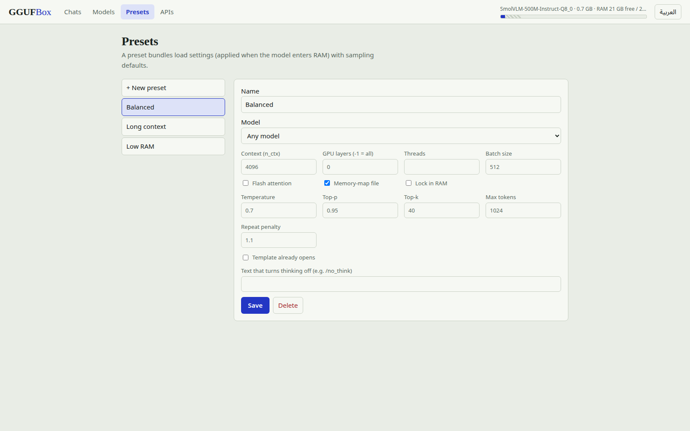
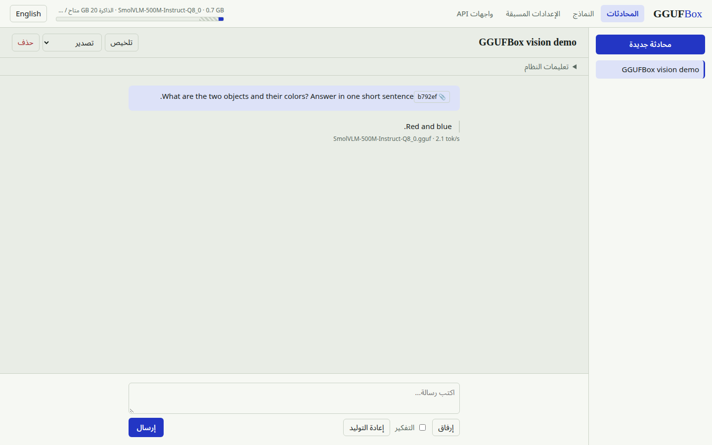

<div align="center">

<h1>GGUFBox</h1>

<p><strong>نماذج GGUF المحلية، بواجهة واحدة بسيطة.</strong></p>

<p>شغّل النماذج على جهازك عبر واجهة ويب عربية وإنجليزية، وREST API ببث مباشر، ونقطة نهاية متوافقة مع OpenAI.</p>

<p><a href="README.ar.md">العربية</a> · <a href="README.md">English</a></p>

<p><code>Python 3.11+</code> · <code>FastAPI</code> · <code>llama.cpp</code> · <code>MIT</code></p>

<p><a href="#openai-sdk">مثال OpenAI SDK</a> · <a href="CONTRIBUTING.md">المساهمة</a> · <a href="SECURITY.md">الأمان</a> · <a href="models/SOURCE.md">المصدر والترخيص</a></p>

<br>



<p><sub>تسجيل حقيقي للواجهة: إدارة النموذج وتحميله ← محادثة رؤية ببث مباشر ← استدعاء ناجح لواجهة API افتراضية.</sub></p>

<div align="center">
  
  
  
</div>

<p><sub>إدارة النماذج · المحادثة المباشرة · إعدادات الذاكرة والتحميل</sub></p>



<p><sub>أنشئ نقطة نهاية مبنية على تعليماتك واختبر مخرجات JSON المنظمة من الواجهة.</sub></p>

</div>

GGUFBox خدمة FastAPI ذاتية الاستضافة تُبقي تشغيل النموذج محليًا، وتحمل نموذج GGUF واحدًا في كل مرة مع أدوات للمساعدة في حماية الذاكرة المتاحة. تُحفظ المحادثات مستقلّة عن النموذج، لذلك يمكنك التبديل بين النماذج دون فقدان سجلّك.

## OpenAI SDK

استخدم مكتبة Python الرسمية مع نقطة النهاية المحلية المتوافقة مع OpenAI. المثال التالي يرسل صورة الاختبار [`docs/vision-test.png`](docs/vision-test.png) ويطبع الإجابة أثناء وصولها. حمّل نموذجًا أولًا؛ وإذا فعّلت `GGUFBOX_API_KEY` فاستبدل `local` بالمفتاح.

```bash
pip install openai
```

```python
import base64
from pathlib import Path
from openai import OpenAI

client = OpenAI(base_url="http://localhost:8000/v1", api_key="local")
image = base64.b64encode(Path("docs/vision-test.png").read_bytes()).decode("ascii")
stream = client.chat.completions.create(
    model="current",
    stream=True,
    max_tokens=32,
    messages=[{"role": "user", "content": [
        {"type": "text", "text": "What color is the object? Answer with one color only."},
        {"type": "image_url", "image_url": {"url": f"data:image/png;base64,{image}"}},
    ]}],
)
for chunk in stream:
    text = chunk.choices[0].delta.content or ""
    if text:
        print(text, end="", flush=True)
```

أعاد الاختبار الفعلي محليًا `Blue`. تعمل مكتبات OpenAI الحالية دون وسيط أو تشغيل للاستدلال في السحابة.

## المزايا

| | |
|---|---|
| **أي نموذج GGUF** | ضع ملفات `.gguf` في `models/`. يُكتشف نوع التكميم والحجم ودعم الرؤية تلقائيًا. |
| **محادثة ببث مباشر (SSE)** | أحداث `meta` و`token` و`reasoning` و`done`. زر الإيقاف يوقف التوليد فعلًا. |
| **محادثات مستقلة عن النموذج** | يُخزَّن السجل كرسائل عادية، ويُطبَّق قالب النموذج الحالي وقت الاستدعاء فقط. |
| **وضع التفكير** | يُفصل الاستدلال (`<think>…</think>`) عن الإجابة ويظهر في كتلة قابلة للطي. يُفعَّل لكل رسالة. |
| **ضبط المعاملات قبل التحميل** | `n_ctx` وطبقات GPU والخيوط والدفعة وflash attention وmmap وmlock، قبل دخول النموذج إلى الذاكرة. |
| **إعدادات مسبقة** | احفظ إعدادات التحميل والتوليد الافتراضية لكل نموذج أو بشكل عام. |
| **حماية الذاكرة** | تقدير مباشر قبل التحميل، ورفض ما لا يتسع، ومراعاة حدود الحاوية، وتفريغ اختياري عند الخمول مع إعادة تحميل تلقائية. |
| **الصور والملفات** | نماذج الرؤية (مع ملف `mmproj`) تقبل الصور، وتُرفق ملفات النص والأكواد وPDF كسياق. |
| **واجهات API افتراضية** | حوّل تعليمات + نموذج + مخطط JSON اختياري إلى نقطة نهاية: `POST /api/v/{slug}`. |
| **التلخيص والتصدير** | لخّص أي محادثة بالنموذج المحمّل، وصدّرها بصيغة Markdown أو JSON أو نص. |
| **متوافق مع OpenAI** | `/v1/models` و`/v1/chat/completions` (بث وصور ومخطط JSON). تعمل المكتبات الحالية دون تعديل. |
| **Docker** | أمر واحد `docker compose up` مع حدود للذاكرة والمعالج. |
| **واجهة ثنائية اللغة** | واجهة وتوثيق بالعربية (RTL) والإنجليزية. |

## لقطات إضافية للواجهة

<div align="center">
  
  
  
</div>

## نموذج رؤية مجرّب

اختُبر مسار الرؤية فعليًا باستخدام **SmolVLM‑500M‑Instruct GGUF** الرسمي من [ggml-org على Hugging Face](https://huggingface.co/ggml-org/SmolVLM-500M-Instruct-GGUF). لا تُضمَّن ملفات الأوزان الكبيرة في مستودع Git؛ نزّل ملف النموذج وملف إسقاط الرؤية المطابق إلى `models/`:
```bash
python -m pip install -U huggingface_hub
hf download ggml-org/SmolVLM-500M-Instruct-GGUF \
  SmolVLM-500M-Instruct-Q8_0.gguf \
  mmproj-SmolVLM-500M-Instruct-Q8_0.gguf \
  --local-dir models
```
يكتشف GGUFBox الزوج ويختار معالج MTMD للرؤية تلقائيًا؛ ويتطلب ذلك `llama-cpp-python` بإصدار 0.3.38 أو أحدث. استخدم صورة الاختبار [`docs/vision-test.png`](docs/vision-test.png) لتجربة الرفع، وتجد المصدر والبصمات في [`models/SOURCE.md`](models/SOURCE.md). **ترخيص كود التطبيق MIT، أما أوزان SmolVLM المنفصلة فترخيصها Apache-2.0 وتظل خاضعة لترخيص مصدرها.**

## البدء السريع

### Docker

```bash
mkdir -p models && cp ~/Downloads/your-model.gguf models/
docker compose up --build
# افتح http://localhost:8000
```

حدّد ما يحق للحاوية استخدامه (يقرأ GGUFBox الحد ويرفض أي تحميل يتجاوزه):

```bash
GGUFBOX_MEM_LIMIT=12g GGUFBOX_CPUS=6 docker compose up -d
```

لبطاقات NVIDIA راجع التعليقات في `Dockerfile` و`docker-compose.yml`.

### محليًا

```bash
python -m venv .venv && source .venv/bin/activate
pip install -r requirements.txt -r requirements-engine.txt
uvicorn app.main:app --port 8000
```

تريد التجربة بلا نموذج؟ شغّل `GGUFBOX_ENGINE=mock uvicorn app.main:app` (أنشئ ملفًا فارغًا `models/demo.gguf` أولًا).
توثيق الـ API التفاعلي على `/docs`.

## الاستخدام

**1. حمّل نموذجًا** (من صفحة *النماذج*) أو عبر الأمر:

```bash
curl -X POST localhost:8000/api/models/load -H 'Content-Type: application/json' \
  -d '{"filename": "qwen3-8b-q4_k_m.gguf", "overrides": {"n_ctx": 8192}}'
```

اعرف كلفة الذاكرة قبل التحميل: `GET /api/models/estimate?filename=…&n_ctx=8192`.
التحميل الذي لا يتسع يعيد `409 insufficient_memory`، وأرسل `"force": true` لتجاوز ذلك.

**2. محادثة ببث مباشر**

```bash
CHAT=$(curl -s -X POST localhost:8000/api/chats -H 'Content-Type: application/json' -d '{}' | jq -r .id)
curl -N -X POST localhost:8000/api/chats/$CHAT/messages -H 'Content-Type: application/json' \
  -d '{"content": "اشرح mmap في فقرة واحدة", "thinking": true}'
```

الأحداث: `meta` ← `token` / `reasoning` ← `done` (مع عدد الرموز في الثانية). استخدم `"stream": false` للحصول على JSON واحد،
و`"regenerate": true` لإعادة الإجابة عن آخر رسالة، و`"attachments": ["<معرّف الرفع>"]` بعد `POST /api/uploads`.

**3. متوافق مع OpenAI**

```python
from openai import OpenAI
client = OpenAI(base_url="http://localhost:8000/v1", api_key="unused")
print(client.chat.completions.create(model="current", messages=[{"role": "user", "content": "مرحبا"}]).choices[0].message.content)
```

تمرير اسم ملف GGUF في `model` يحمّل ذلك النموذج عند الطلب (يُعطَّل بـ `GGUFBOX_AUTO_LOAD=false`).

**4. واجهات API افتراضية**: تعليمات محفوظة تتحول إلى نقطة نهاية.

```bash
curl -X POST localhost:8000/api/virtual-apis -H 'Content-Type: application/json' -d '{
  "slug": "sentiment", "name": "تحليل المشاعر",
  "system_prompt": "صنّف مشاعر النص.",
  "input_template": "النص: {{input}}",
  "output_schema": {"type":"object","properties":{"label":{"enum":["positive","neutral","negative"]},"score":{"type":"number"}},"required":["label","score"]}
}'
curl -X POST localhost:8000/api/v/sentiment -H 'Content-Type: application/json' -d '{"input": "أحببت هذا!"}'
# {"output": {"label": "positive", "score": 0.97}, "model": "...", "usage": {...}}
```

مع `output_schema` يكون التوليد مقيّدًا بقواعد نحوية ويُعاد JSON مُحلَّلًا. أضف `"stream": true` للحصول على SSE.

## الإعدادات

كل المتغيرات اختيارية وتبدأ بـ `GGUFBOX_` (انظر `.env.example`).

| المتغير | الافتراضي | المعنى |
|---|---|---|
| `ENGINE` | `llama_cpp` | `llama_cpp` أو `mock` |
| `MODELS_DIR` / `DATA_DIR` | `./models` / `./data` | ملفات GGUF / قاعدة SQLite والمرفوعات |
| `API_KEY` | لا شيء | اشترط `Authorization: Bearer <key>` (أو `x-api-key`) على `/api` و`/v1` |
| `RAM_BUDGET_FRACTION` | `0.85` | ارفض التحميل المقدَّر فوق هذه النسبة من الذاكرة الحرة |
| `IDLE_UNLOAD_SECONDS` | `0` | فرّغ الذاكرة بعد هذه المدة من الخمول، ويعود النموذج عند الطلب التالي |
| `AUTO_LOAD` | `true` | اسمح لـ `/v1` والواجهات الافتراضية بتحميل النموذج المطلوب |
| `MAX_UPLOAD_MB` / `MAX_FILE_CHARS` | `20` / `24000` | حجم الرفع / عدد أحرف الملف المرفق المرسلة للنموذج |

## المعمارية

```
 واجهة الويب ─┐
 REST  ───────┼─► api/ (المسارات والتحقق) ─► services/ ─► engine/ (llama.cpp خلف واجهة مجردة)
 /v1  ────────┘                                │
                                               └─► db/ (مستودعات SQLite)
```

| الطبقة | المسؤولية |
|---|---|
| `app/api` | HTTP فقط: المسارات والمصادقة وتنسيق SSE، بلا منطق أعمال. |
| `app/services/model_manager.py` | النموذج المحمّل الوحيد: الاكتشاف وفحص الذاكرة والتحميل والتفريغ والتفريغ عند الخمول وتسلسل التوليد. |
| `app/services/completion.py` | التوليد بلا حالة وفصل الاستدلال عن الإجابة، ويُستخدم في المحادثات و`/v1` والواجهات الافتراضية. |
| `app/services/chat_service.py` | المحادثات: ملاءمة السياق والمرفقات والحفظ والتلخيص والتصدير. |
| `app/engine` | واجهة `Engine` وتنفيذا `llama_cpp` و`mock` وجسر الخيط إلى async مع الإلغاء. |
| `app/db` | المخطط والمستودعات. |

قرارات تصميم تستحق المعرفة:

- **المحرّك واجهة مجردة.** استبدل llama.cpp بمحرك آخر بتنفيذ أربع دوال.
- **توليد واحد في كل مرة.** سياقات llama.cpp ليست آمنة للخيوط، فيُسلسَل التوليد وينتظر التحميل انتهاء الإجابة الجارية.
- **الإيقاف يعني الإيقاف.** إغلاق البث يضبط علامة إلغاء يفحصها الخيط عند كل رمز، وتُحفظ الإجابة الجزئية.
- **السياق لا يفيض بصمت.** تُحذف أقدم الرسائل لتناسب `n_ctx − max_tokens`، ويُبلغ حدث `meta` بعددها.
- **إيقاف التفكير صادق.** يُهمَل الاستدلال من المخرجات، وللنماذج ذات المفتاح النصي اضبطه في الإعداد المسبق (`think_off_directive` مثل `/no_think`). وإن كان القالب يفتح `<think>` مسبقًا فعّل `think_prefilled`.

## ملاحظات وحدود

- تقدير الذاكرة تقريبي (الأوزان + حد محافظ لذاكرة KV). هو حاجز وقائي لا ضمان.
- الرؤية تحتاج ملف `mmproj` بجانب النموذج. يُختار المعالج من اسم الملف، ويمكن تجاوزه بـ `vision_handler`. أعطِ نماذج الرؤية `n_ctx` أكبر.
- `output_schema` في الواجهات الافتراضية يعتمد على JSON المقيّد بقواعد في llama.cpp، وقد تبطؤ المخططات الكبيرة جدًا.
- الأمان: اضبط `GGUFBOX_API_KEY` قبل فتح المنفذ خارج localhost.

## التطوير

```bash
pip install -r requirements-dev.txt
GGUFBOX_ENGINE=mock pytest
```

## خارطة الطريق

تنزيل النماذج من داخل الواجهة، وتثبيت نموذج لكل محادثة، ونقطة نهاية للتضمينات، ومكتبة تعليمات، وإحصاءات الاستخدام.

## ملفات المشروع

- [دليل المساهمة](CONTRIBUTING.md) · [سياسة الأمان](SECURITY.md) · [قواعد السلوك](CODE_OF_CONDUCT.md)
- [سجل التغييرات](CHANGELOG.md) · [قائمة تجهيز النشر على GitHub](docs/GITHUB_PUBLISHING.md)
- [مصدر نموذج الرؤية وترخيصه وبصماته](models/SOURCE.md)

## الترخيص

كود GGUFBox مرخّص بموجب MIT. أما أوزان النماذج والملفات الخارجية فتظل خاضعة لتراخيص مصادرها. راجع [`LICENSE`](LICENSE) و[توثيق مصدر نموذج الرؤية](models/SOURCE.md).
