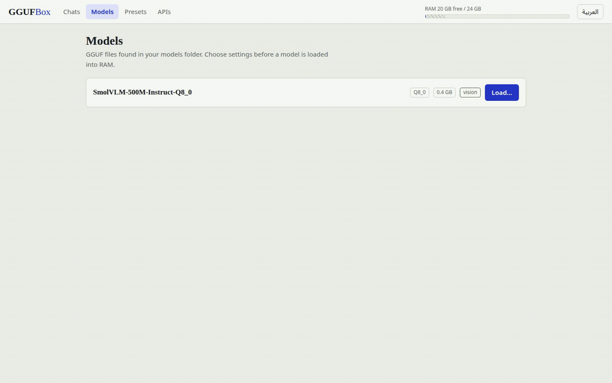
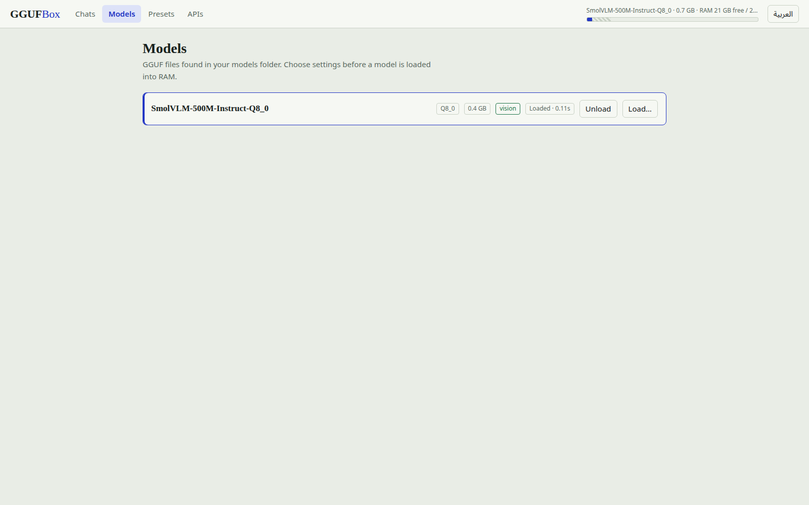
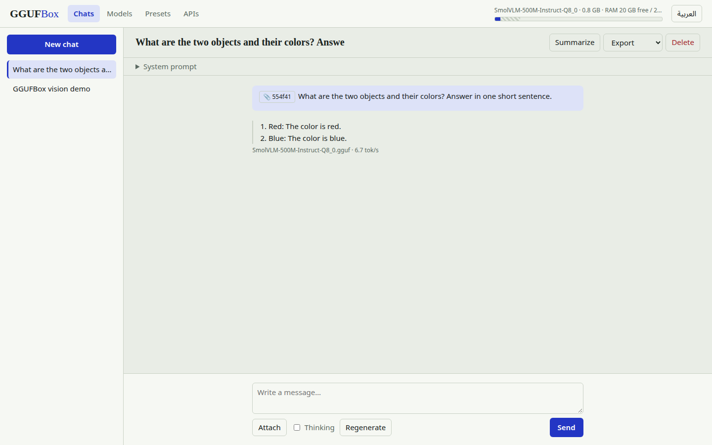
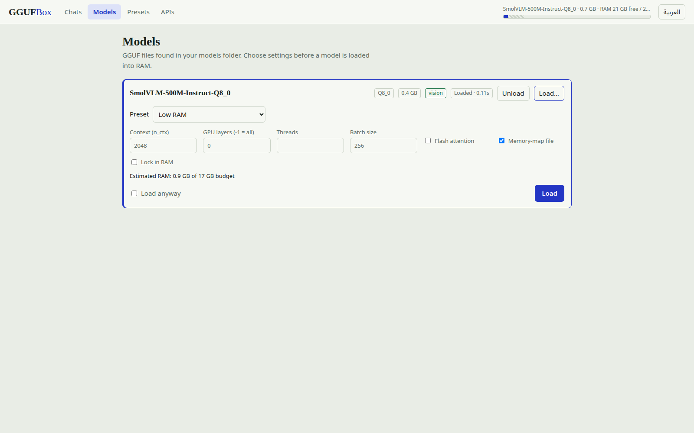
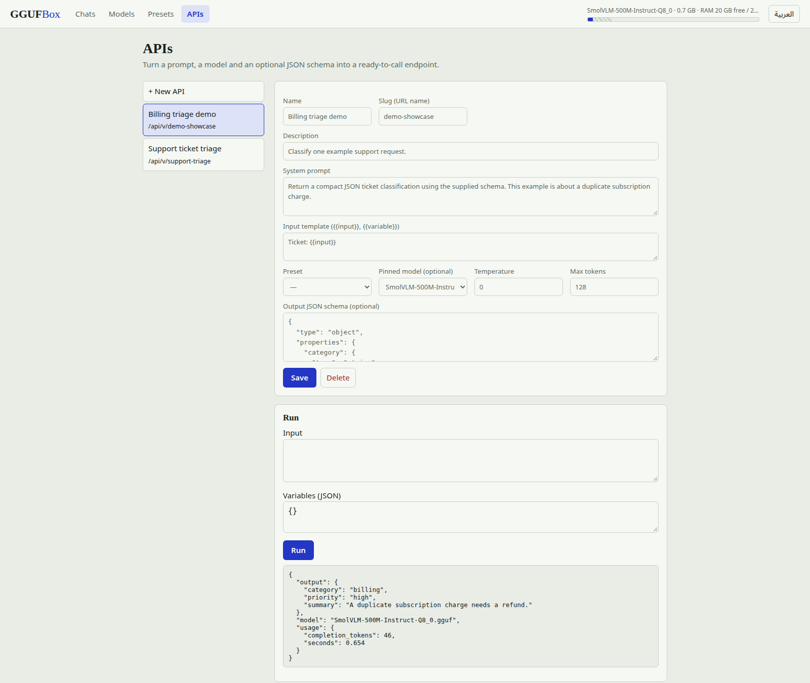
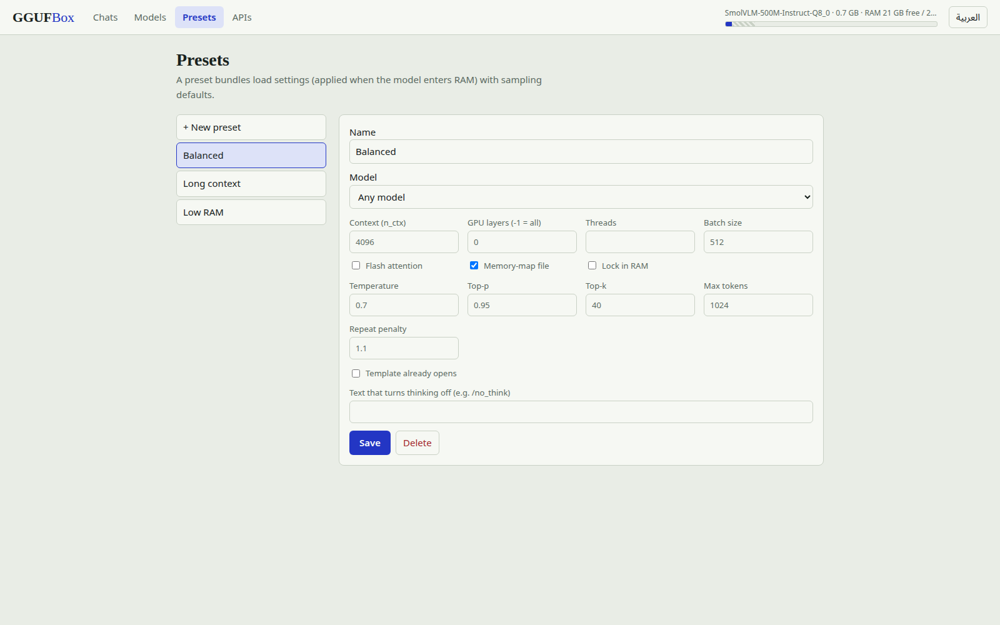
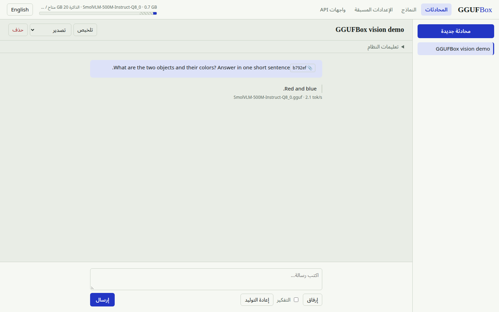
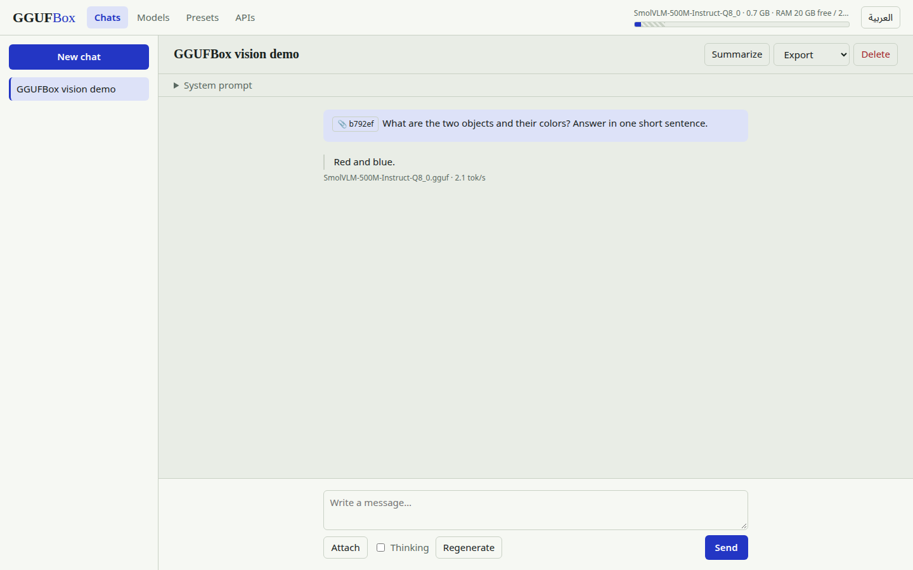

<div align="center">

<h1>GGUFBox</h1>

<p><strong>Your local GGUF models, one clean interface.</strong></p>

<p>Run inference on your own machine through a bilingual web UI, streaming REST API, or OpenAI-compatible endpoint.</p>

<p><a href="README.md">English</a> · <a href="README.ar.md">العربية</a></p>

<p><code>Python 3.11+</code> · <code>FastAPI</code> · <code>llama.cpp</code> · <code>MIT</code></p>

<p><a href="#quick-start">Quick start</a> · <a href="#features">Features</a> · <a href="#openai-sdk">OpenAI SDK</a> · <a href="#using-it">API examples</a> · <a href="CONTRIBUTING.md">Contributing</a> · <a href="SECURITY.md">Security</a></p>

<br>



<p><sub>Real UI recording: model management and load → streamed vision chat → a successful Virtual API call.</sub></p>

<div align="center">
  
  
  
</div>

<p><sub>Model management · live chat · memory and loading controls</sub></p>



<p><sub>Create a prompt-backed endpoint and test its structured JSON output in the UI.</sub></p>

</div>

GGUFBox is a self-hosted FastAPI service that keeps model execution local, loads one GGUF model at a time, and helps protect available RAM. Chats are stored independently of the model, so you can switch models without losing conversation history.

## OpenAI SDK

Use the official Python SDK against GGUFBox's local OpenAI-compatible endpoint. This tested example streams a vision response from the bundled [`docs/vision-test.png`](docs/vision-test.png). Load a model first; if `GGUFBOX_API_KEY` is enabled, replace `local` with that key.

```bash
pip install openai
```

```python
import base64
from pathlib import Path
from openai import OpenAI

client = OpenAI(base_url="http://localhost:8000/v1", api_key="local")
image = base64.b64encode(Path("docs/vision-test.png").read_bytes()).decode("ascii")
stream = client.chat.completions.create(
    model="current",
    stream=True,
    max_tokens=32,
    messages=[{"role": "user", "content": [
        {"type": "text", "text": "What color is the object? Answer with one color only."},
        {"type": "image_url", "image_url": {"url": f"data:image/png;base64,{image}"}},
    ]}],
)
for chunk in stream:
    text = chunk.choices[0].delta.content or ""
    if text:
        print(text, end="", flush=True)
```

The real local run returned `Blue`. Existing OpenAI Python SDK clients work without a proxy or cloud inference service.

## Features

| | |
|---|---|
| **Run any GGUF** | Drop `.gguf` files in `models/`. Quantization, size and vision support are detected automatically. |
| **Streaming chat (SSE)** | `meta`, `token`, `reasoning`, `done` events. Press Stop and generation really stops. |
| **Model-neutral chats** | History is stored as plain messages; the loaded model's template is applied only at call time. |
| **Thinking mode** | Reasoning (`<think>…</think>`) is split from the answer and shown in a collapsible block. Toggle per message. |
| **Hyperparameters before loading** | `n_ctx`, GPU layers, threads, batch, flash attention, mmap, mlock, edited *before* the model enters RAM. |
| **Presets** | Save load settings and sampling defaults per model or globally. |
| **RAM protection** | Live estimate before loading, refusal when it will not fit, container-limit aware, optional idle unload with automatic reload. |
| **Images and files** | Vision models (with an `mmproj` file) accept images; text, code and PDF files are attached as context. |
| **Virtual APIs** | Turn a prompt + model + optional JSON schema into an endpoint: `POST /api/v/{slug}`. |
| **Summaries and export** | Summarize any chat with the loaded model; export as Markdown, JSON or text. |
| **OpenAI-compatible** | `/v1/models` and `/v1/chat/completions` (streaming, images, JSON schema). Existing SDKs work unchanged. |
| **Docker** | One `docker compose up`, with memory and CPU limits. |
| **Bilingual UI** | English and Arabic (RTL) interface and documentation. |

### More screenshots

<div align="center">
  
  
  
</div>

### Verified vision demo model

The real vision path was smoke-tested with the official [ggml-org SmolVLM-500M-Instruct GGUF](https://huggingface.co/ggml-org/SmolVLM-500M-Instruct-GGUF). The large model binaries are intentionally not stored in this Git repository; download the matching weights and vision projector into `models/`:

```bash
python -m pip install -U huggingface_hub
hf download ggml-org/SmolVLM-500M-Instruct-GGUF \
  SmolVLM-500M-Instruct-Q8_0.gguf \
  mmproj-SmolVLM-500M-Instruct-Q8_0.gguf \
  --local-dir models
```

GGUFBox detects the pair and selects llama.cpp's MTMD multimodal handler automatically; this requires `llama-cpp-python` 0.3.38 or newer. Use [`docs/vision-test.png`](docs/vision-test.png) to exercise image upload. Source details and SHA-256 digests are in [`models/SOURCE.md`](models/SOURCE.md). **The application code is MIT-licensed; the separately hosted SmolVLM weights are Apache-2.0 and remain subject to their upstream license.**

## Quick start

### Docker

```bash
mkdir -p models && cp ~/Downloads/your-model.gguf models/
docker compose up --build
# open http://localhost:8000
```

Limit what the container may use (GGUFBox reads the limit and refuses loads that would exceed it):

```bash
GGUFBOX_MEM_LIMIT=12g GGUFBOX_CPUS=6 docker compose up -d
```

For NVIDIA GPUs see the comments in `Dockerfile` and `docker-compose.yml`.

### Local

```bash
python -m venv .venv && source .venv/bin/activate
pip install -r requirements.txt -r requirements-engine.txt
uvicorn app.main:app --port 8000
```

Want to look around without a model? `GGUFBOX_ENGINE=mock uvicorn app.main:app` runs a fake engine (create an empty
`models/demo.gguf` first). Interactive API docs live at `/docs`.

## Using it

**1. Load a model** (UI: *Models*), or:

```bash
curl -X POST localhost:8000/api/models/load -H 'Content-Type: application/json' \
  -d '{"filename": "qwen3-8b-q4_k_m.gguf", "overrides": {"n_ctx": 8192}}'
```

Check the RAM cost first with `GET /api/models/estimate?filename=…&n_ctx=8192`.
A load that will not fit returns `409 insufficient_memory`; send `"force": true` to override.

**2. Chat with streaming**

```bash
CHAT=$(curl -s -X POST localhost:8000/api/chats -H 'Content-Type: application/json' -d '{}' | jq -r .id)
curl -N -X POST localhost:8000/api/chats/$CHAT/messages -H 'Content-Type: application/json' \
  -d '{"content": "Explain mmap in one paragraph", "thinking": true}'
```

Events: `meta` → `token`* / `reasoning`* → `done` (with tokens/second). Set `"stream": false` for one JSON response,
`"regenerate": true` to re-answer the last message, `"attachments": ["<upload id>"]` after `POST /api/uploads`.

**3. OpenAI-compatible**

```python
from openai import OpenAI
client = OpenAI(base_url="http://localhost:8000/v1", api_key="unused")
print(client.chat.completions.create(model="current", messages=[{"role": "user", "content": "Hi"}]).choices[0].message.content)
```

Passing a GGUF filename as `model` loads that model on demand (disable with `GGUFBOX_AUTO_LOAD=false`).

**4. Virtual APIs**: a saved prompt becomes an endpoint.

```bash
curl -X POST localhost:8000/api/virtual-apis -H 'Content-Type: application/json' -d '{
  "slug": "sentiment", "name": "Sentiment",
  "system_prompt": "Classify the sentiment of the text.",
  "input_template": "Text: {{input}}",
  "output_schema": {"type":"object","properties":{"label":{"enum":["positive","neutral","negative"]},"score":{"type":"number"}},"required":["label","score"]}
}'
curl -X POST localhost:8000/api/v/sentiment -H 'Content-Type: application/json' -d '{"input": "I love this!"}'
# {"output": {"label": "positive", "score": 0.97}, "model": "...", "usage": {...}}
```

With an `output_schema`, generation is grammar-constrained and the response is parsed JSON. Add `"stream": true` for SSE.

## Configuration

All variables are optional and prefixed with `GGUFBOX_` (see `.env.example`).

| Variable | Default | Meaning |
|---|---|---|
| `ENGINE` | `llama_cpp` | `llama_cpp` or `mock` |
| `MODELS_DIR` / `DATA_DIR` | `./models` / `./data` | GGUF files / SQLite database and uploads |
| `API_KEY` | none | Require `Authorization: Bearer <key>` (or `x-api-key`) on `/api` and `/v1` |
| `RAM_BUDGET_FRACTION` | `0.85` | Refuse loads estimated above this share of free RAM |
| `IDLE_UNLOAD_SECONDS` | `0` | Free RAM after this much idle time; the model reloads on the next request |
| `AUTO_LOAD` | `true` | Let `/v1` and virtual APIs load the model they ask for |
| `MAX_UPLOAD_MB` / `MAX_FILE_CHARS` | `20` / `24000` | Upload size / characters of an attached file sent to the model |

## Architecture

```
 Web UI ─┐
 REST  ──┼─► api/ (routers, validation) ─► services/ ─► engine/ (llama.cpp behind an interface)
 /v1  ───┘                                    │
                                              └─► db/ (SQLite repositories)
```

| Layer | Responsibility |
|---|---|
| `app/api` | HTTP only: routes, auth, SSE framing. No business logic. |
| `app/services/model_manager.py` | The one loaded model: discovery, RAM checks, load/unload, idle unload, serialised generation. |
| `app/services/completion.py` | Stateless generation and reasoning/answer splitting, shared by chats, `/v1` and virtual APIs. |
| `app/services/chat_service.py` | Chats: context fitting, attachments, persistence, summaries, export. |
| `app/engine` | `Engine` interface, `llama_cpp` and `mock` implementations, thread-to-async bridge with cancellation. |
| `app/db` | Schema and repositories. |

Design decisions worth knowing:

- **The engine is an interface.** Swap llama.cpp for another backend by implementing four methods.
- **One generation at a time.** llama.cpp contexts are not thread-safe, so generations are serialised and a load waits for the running answer.
- **Stop means stop.** Closing the stream sets a cancel flag that the worker thread checks on every token, and the partial answer is saved.
- **Context never silently overflows.** Oldest messages are dropped to fit `n_ctx − max_tokens`; the `meta` event reports how many.
- **Thinking off is honest.** Reasoning is discarded from the output; for models with a soft switch, set it in the preset (`think_off_directive`, e.g. `/no_think`). If the template already opens `<think>`, enable `think_prefilled`.

## Notes and limits

- The RAM estimate is a heuristic (weights + a conservative KV-cache term). It is a guard rail, not a guarantee.
- Vision needs an `mmproj` GGUF next to the model. The handler is picked from the filename; override it with `vision_handler` if needed. Give vision models a larger `n_ctx`.
- Virtual API `output_schema` relies on llama.cpp grammar-constrained JSON; very large schemas can be slow.
- Security: set `GGUFBOX_API_KEY` before exposing the port beyond localhost.

## Development

```bash
pip install -r requirements-dev.txt
GGUFBOX_ENGINE=mock pytest
```

## Roadmap

In-app model downloads, per-chat model pinning, an embeddings endpoint, a prompt library, and usage statistics.

## Project resources

- [Contributing guide](CONTRIBUTING.md) · [Security policy](SECURITY.md) · [Code of conduct](CODE_OF_CONDUCT.md)
- [Changelog](CHANGELOG.md) · [GitHub publishing checklist](docs/GITHUB_PUBLISHING.md)
- [Vision model source, license, and SHA-256 checksums](models/SOURCE.md)

## License

GGUFBox application code is MIT-licensed. Downloaded model weights and other third-party assets remain under their respective upstream licenses. See [`LICENSE`](LICENSE) and the [vision model provenance notes](models/SOURCE.md).
